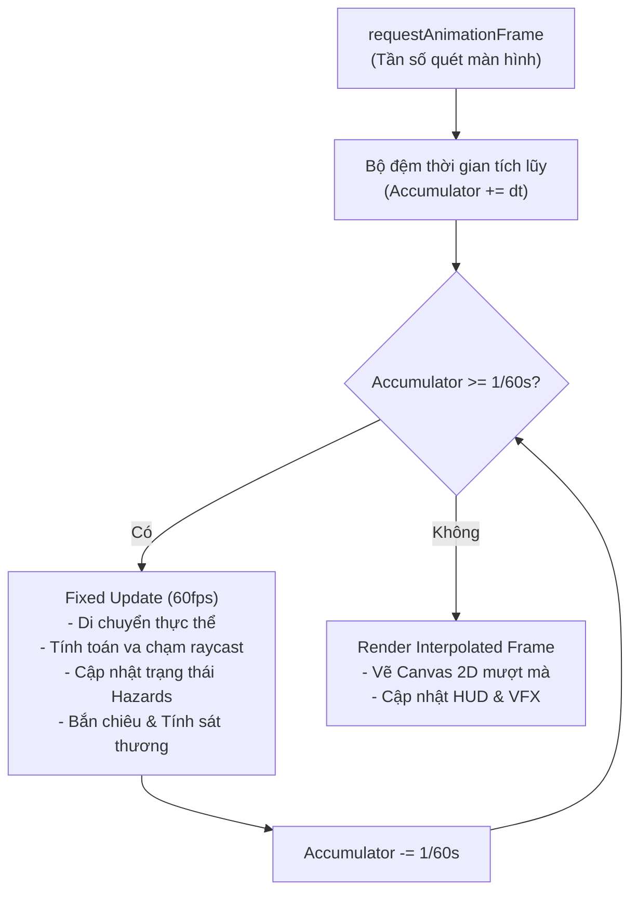

# Kiến Trúc Hệ Thống & Kỹ Thuật Dự Án — ViTrainer
*(ViTrainer System Architecture, Codebase Design & Technical Reference)*

---

## 1. Cấu Trúc Thư Mục Dự Án (Project Structure)

```
ViTrainer/
├── assets/                  # Tài nguyên đồ họa, âm thanh, spritesheets
│   ├── audio/              # Nhạc nền BGM & Hiệu ứng SFX (.mp3, .ogg)
│   ├── data/               # Dữ liệu ảnh nén và metadata sprites
│   ├── icons/              # Biểu tượng web ViTrainer.ico, ViTrainer.png
│   └── sprites/            # SpriteCollab animation sheets
├── css/                    # Kiểu dáng giao diện giao thoa Retro & Dark Mode
├── docs/                   # Bộ tài liệu kỹ thuật & gameplay toàn diện 100% Tiếng Việt
├── js/                     # Mã nguồn logic JavaScript mô-đun hóa
│   ├── core/               # updater.js, db.js, i18n.js, sprites.js
│   ├── data/               # pokedex.js, moves.js, megas.js, items.js, enemies.js, lang-*.js
│   ├── entities/           # player.js, enemy.js, boss.js
│   ├── net/                # coop.js, net-codec.js (Mã hóa nhị phân v1 WebRTC)
│   ├── systems/            # combat.js, levelup.js, rift.js, judgment.js, hazards.js
│   └── ui/                 # menu.js, settings-ui.js, login.js, run-ui.js
├── tests/                  # Bộ kiểm thử tự động (i18n.test.cjs, buffs.test.cjs, net.test.cjs)
├── tools/                  # Pipeline biên dịch (build.js, export_data.js, make_seo_pages.py)
├── dev.html                # Tệp tin nguồn giao diện gốc (MỌI CHỈNH SỬA THỰC HIỆN TẠI ĐÂY)
├── index.html              # Bản build nén và xáo trộn (SINH TỰ ĐỘNG, KHÔNG SỬA TRỰC TIẾP)
└── version.json            # Mã băm phiên bản tự động phục vụ Live Updater
```

---

## 2. Vòng Đời Vận Hành & Khung Lặp Cố Định (Game Lifecycle & Fixed Timestep)

ViTrainer áp dụng mô hình phân tách độc lập giữa tính toán vật lý (**Fixed Timestep 60fps**) và khung hình hiển thị (**Decoupled Render Loop**):



- **Fixed Timestep (1/60 giây = 16.67ms)**: Mọi phép tính toán vị trí, gia tốc, thời gian hồi chiêu và va chạm đều diễn ra ở tần số cố định, đảm bảo game chạy chuẩn xác trên mọi thiết bị (từ màn hình 60Hz đến 144Hz/240Hz).
- **Interpolation Rendering**: Khi render, vị trí thực thể được nội suy mượt mà giữa trạng thái trước và trạng thái hiện tại.

---

## 3. Kiến Trúc Các Phân Hệ Cốt Lõi (Core Engine Subsystems)

### 3.1. Động Cơ Chiến Đấu & Chiêu Thức (`js/systems/combat.js` & `js/data/moves.js`)
- **139 Chiêu thức chuẩn canon**: Phân định rành mạch giữa Vật Lý (`cat: 'physical'`) và Đặc Biệt / Phép (`cat: 'special'`).
- **Hệ thống Dung hợp Chiêu (Bond System)**: Cho phép kết hợp tối đa 4 chiêu trong một ô (`BOND_MAX = 4`), đồng thời kích hoạt khi người chơi tung đòn.
- **Tiến hóa chiêu 3 nấc (+, ++, +++)**:
  - `+`: Cường hóa sát thương và giảm hồi chiêu.
  - `++`: Mở rộng phạm vi và tăng số lượng tia đạn.
  - `+++` (Mastery Tối Thượng): Điều kiện mở khóa chỉ cần **01 chiêu đạt cấp ++** và **01 chiêu đạt cấp +** khác trong bộ chiêu hiện có.
- **Cơ chế chiêu thức độc quyền (Signature Moves)**: Chiếu tia thiêu đốt duy trì (*Continuous Beam*), hút máu sinh lực (*Lifesteal*), chuỗi lôi điện (*Chain Lightning*), ru ngủ diện rộng (*Sleep Vortex*), đóng băng tuyệt đối (*Freeze Stun*).

### 3.2. Hệ Thống Người Chơi & Cân Bằng Tiến Hóa (`js/entities/player.js`)
- **Cân bằng chỉ số 3 bậc**:
  - *Dạng 1*: $+35\%$ Tấn công, $+35\%$ Máu tối đa, $+8\%$ Tốc độ di chuyển.
  - *Dạng 2*: $+28\%$ Tấn công, $+25\%$ Máu, $+10\%$ Tốc độ (tương đương baseline 500 BST của Pokémon đơn bậc), hồi $50\%$ Máu.
  - *Dạng 3*: $+45\%$ Tấn công, $+45\%$ Máu, $+20\%$ Tốc độ (nhỉnh hơn dạng 2 khoảng $30\%$), hồi $50\%$ Máu.
- **Dạng Mega / Thần Năng**: Nhận $+50\%$ Tấn công, $+45\%$ Máu, $+25\%$ Tốc độ, $+15\%$ Chí mạng, $-20\%$ Sát thương gánh chịu, $-15\%$ Giảm hồi chiêu, hồi đầy $100\%$ Máu.
- **Hào quang Thần Năng (Mega Aura)**: Quét sóng xung kích 360 độ đẩy lùi kẻ địch mỗi 2.2 giây.
- **Phân định Giáp Độc Lập**:
  - Giáp Vật Lý (`pdefReduce`) & Giáp Phép (`sdefReduce`), mỗi loại nâng tối đa 8 cấp (+70% giảm sát thương).
  - Tương tác với *Assault Vest* (+20% giảm sát thương độc lập nhân sau cùng ngoài trần 70%).

### 3.3. Động Cơ Kẻ Địch & Đại Boss Đa Phase (`js/entities/enemy.js` & `js/data/enemies.js`)
- **Boss Chu kỳ 180 giây**: Máu và sát thương scale theo thời gian thực qua hàm `bossScale(t)`, làm dịu tốc độ tăng trưởng sau phút 20 để tránh boss bất tử.
- **One-Shot Protection**: Không có bất kỳ đòn đánh nào từ Boss được gây vượt quá **40% Máu tối đa** của người chơi trong 1 lần đánh.
- **3 Phase tiến hóa**:
  - Phase 1 (100% - 60% HP): Trạng thái bình thường.
  - Phase 2 (Dưới 60% HP): Cuồng Nộ (*Enrage*), $+25\%$ tốc độ, giảm $20\%$ thời gian báo chiêu, triệu hồi đệ tử hỗ trợ, tăng số lượng tia hazards, nhận 2 giây Kháng Hiệu Ứng.
  - Phase 3 (Dưới 30% HP): Thức Tỉnh Mega / Biến đổi hình thể khổng lồ, mở khóa đại chiêu.
- **Cửa sổ sơ hở (`VULNERABLE!`)**: Kéo dài 1.5 giây sau mỗi đòn đánh lớn, Boss nhận thêm **$+50\%$ sát thương**.

### 3.4. Hệ Thống Cổng Không Gian (Dimensional Rifts — `js/systems/rift.js`)
- **Hàng đợi an toàn (Rift Timeline Queue)**: Nếu đến mốc thời gian mở cổng mà Boss đang xuất hiện, hệ thống sẽ chờ Boss chết mới mở cổng, không làm mất mốc sự kiện.
- **3 Tầng Fallback vị trí**: Cự ly xa $\rightarrow$ cự ly trung bình $\rightarrow$ ngay cạnh người chơi, bảo đảm cổng luôn được mở thành công.

### 3.5. Hệ Thống Mạng Nhị Phân WebRTC Co-op 8 Người (`js/net/coop.js` & `net-codec.js`)
- Kết nối P2P qua Google STUN (`stun.l.google.com:19302`).
- Bộ mã hóa nhị phân **Binary Packet Codec v1**: Tiết kiệm $>30\%$ băng thông so với JSON thuần.
- Đồng bộ chuyển phase Boss và tiến hóa đồng đội theo thời gian thực.
- Tạm dừng khi có người mất kết nối và nút vàng tái kết nối liền mạch (*Seamless Rejoin*).

### 3.6. Hệ Thống Dữ Liệu & Liên Kết Tài Khoản (`js/core/db.js`)
- Lưu trữ đám mây không tốn chi phí trên Firebase Spark (Firestore + Authentication).
- Cơ chế liên kết tài khoản linh hoạt:
  - Cho phép người chơi dùng tài khoản **Google** liên kết thêm **Tên tài khoản & Mật khẩu** thuần (`linkPassword`).
  - Cho phép người chơi dùng **Tên/Mật khẩu** liên kết tài khoản **Google** (`linkGoogle`).
  - Cả hai phương thức cùng trỏ về một UID và cùng một file save duy nhất.

---

## 4. Quy Chuẩn Biên Dịch & Đóng Gói (Build & Deploy Standards)

Tuân thủ nghiêm ngặt theo quy định trong [`AGENTS.md`](file:///e:/GameMaking/pokesurvivor/AGENTS.md):
1. Không sửa trực tiếp `index.html`.
2. Chạy pipeline đóng gói:
   ```bash
   node tools/build.js && node tools/export_data.js && python tools/make_seo_pages.py
   ```
3. Chạy toàn bộ kiểm thử tự động:
   ```bash
   node --test tests/i18n.test.cjs tests/buffs.test.cjs tests/net.test.cjs
   ```
4. Không đưa AI branding hay Co-Authored-By vào git commit.
