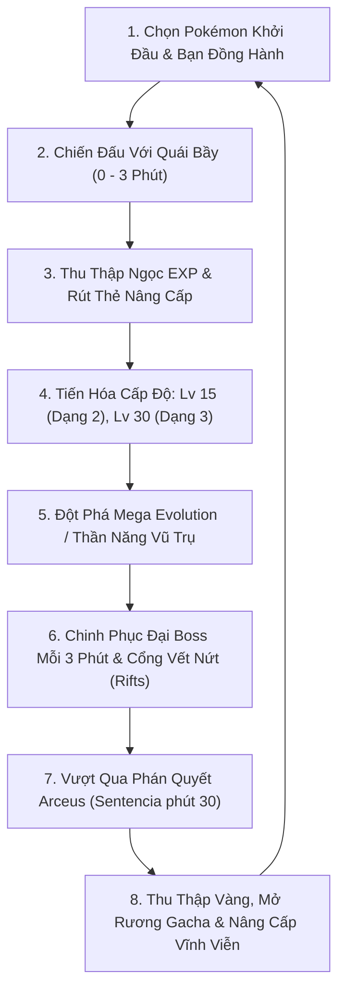

# Cẩm Nang Gameplay & Cơ Chế Hoạt Động Toàn Tập — ViTrainer
*(ViTrainer Comprehensive Gameplay & Systems Manual)*

---

## 1. Tổng Quan Trò Chơi (Game Overview)

**ViTrainer** là một tựa game hành động sinh tồn rogue-lite kết hợp phong cách đồ họa hoài niệm *Pokémon Mystery Dungeon* và lối chơi cuốn hút của dòng *Survivor*. Người chơi sẽ đồng hành cùng Pokémon khởi đầu, chiến đấu chống lại hàng ngàn quái vật hoang dã tràn ngập bản đồ, thu thập kinh nghiệm để lên cấp, tiến hóa hình thái, học và dung hợp các chiêu thức hủy diệt, đánh bại các Đại Boss thần thoại và vượt qua Phán Quyết của Thẩm Phán Arceus ở phút thứ 30.

Trò chơi chạy mượt mà trực tiếp trên mọi trình duyệt web hiện đại (máy tính và điện thoại di động) hoàn toàn miễn phí, hỗ trợ chơi đơn và chơi phối hợp nhiều người (**Multiplayer Co-op tối đa 8 người**).

---

## 2. Vòng Lặp Trò Chơi Cốt Lõi (Core Gameplay Loop)

---

## 3. Hệ Thống Pokémon & Cân Bằng Tiến Hóa Động

### 3.1. Pokédex 1.021 Loài & Độ Hiếm (Rarity)
- Toàn bộ Pokémon từ Thế hệ 1 đến Thế hệ 9 được phân loại theo tổng chỉ số cơ bản (**BST**) và độ hiếm từ 1 Sao đến 5 Sao.
- **6 Chỉ số chiến đấu cốt lõi**:
  - `HP`: Máu cơ bản.
  - `PA` / `SA`: Tấn công Vật Lý (*Physical Attack*) & Tấn công Phép (*Special Attack*).
  - `DF` / `SD`: Phòng thủ Vật Lý (*Physical Defense*) & Phòng thủ Phép (*Special Defense*).
  - `SPD`: Tốc độ di chuyển trên chiến trường.

### 3.2. Thuật Toán Cân Bằng Chỉ Số 3 Bậc (Stage Balance)
Để khắc phục điểm yếu của các loài 3 bậc ở giai đoạn đầu game, ViTrainer áp dụng cơ chế tự động bù trừ chỉ số:
- **Dạng 1 (Đầu game)**: Nhận thêm **$+35\%$ Tấn công**, **$+35\%$ Máu tối đa**, và **$+8\%$ Tốc độ di chuyển**. Giúp người chơi dễ dàng vượt qua các đợt quái đầu mà không bị quá đuối sức.
- **Dạng 2 (Cấp 15 — Middle Stage)**: Tương đương chỉ số của một Pokémon đơn bậc mạnh mẽ (~$500$ BST baseline: $+28\%$ Tấn công, $+25\%$ Máu, $+10\%$ Tốc độ). Khi tiến hóa, Pokémon được **hồi phục ngay 50% Máu tối đa**.
- **Dạng 3 (Cấp 30 — Final Stage)**: Dạng tối thượng ($+45\%$ Tấn công, $+45\%$ Máu, $+20\%$ Tốc độ), nhỉnh hơn dạng 2 khoảng $30\%$, hồi phục ngay 50% Máu tối đa.

### 3.3. Dạng Đặc Biệt: Mega Evolution, Primal Reversion & Ultra Burst
- **Chỉ số bùng nổ khi thức tỉnh**: Tăng ngay **$+50\%$ Tấn công**, **$+45\%$ Máu tối đa**, **$+25\%$ Tốc độ chạy**, **$+15\%$ Tỉ lệ Chí Mạng**, **$-20\%$ Sát thương gánh chịu**, **$-15\%$ Thời gian hồi chiêu**, và hồi phục đầy 100% Máu.
- **Hào quang Thần Năng (Mega Aura)**: Mỗi 2.2 giây tự động phát ra một vòng sóng năng lượng 360 độ hất văng và gây sát thương diện rộng lên toàn bộ quái vật áp sát.
- **Dòng tiến hóa Zygarde**: 10% (Lv. 1-9) $\rightarrow$ 50% (Lv. 10-24) $\rightarrow$ 100% Titan (Lv. 25+, tặng ô chiêu thứ 5 và chiêu độc quyền *Core Enforcer*) $\rightarrow$ Mega Zygarde (Lv. 50 + tiêu diệt 3500 quái, mở khóa chùm sáng hủy diệt *Nihil Light*).

---

## 4. Hệ Thống 139 Chiêu Thức Chiến Đấu & Dung Hợp (Bonds)

### 4.1. Phân Loại Chuẩn Canon: Vật Lý vs Đặc Biệt
Tất cả 139 chiêu thức trong game được chuẩn hóa 100% theo Bulbapedia và Pokémon Showdown:
- **Chiêu Vật Lý (Physical Moves)**: Dùng chỉ số `PA` của Pokémon và bị cản bởi Giáp Vật Lý (`PDEF`) của kẻ địch.
- **Chiêu Đặc Biệt / Phép (Special Moves)**: Dùng chỉ số `SA` của Pokémon và bị cản bởi Giáp Phép (`SDEF`) của kẻ địch.

### 4.2. Cơ Chế Chiêu Thức Độc Quyền (Signature Moves)
Các chiêu thức tối thượng của Pokémon Huyền thoại sở hữu cơ chế gameplay hoàn toàn khác biệt:
- **Chùm tia thiêu đốt duy trì (*Continuous Beam*)**: Chiếu cố định vào 1 quái vật mục tiêu cho đến khi bị tiêu diệt rồi lập tức đổi mục tiêu khác; điểm hồi chiêu chuyển thành tốc độ thiêu đốt tăng nhanh.
- **Hút máu sinh lực (*Lifesteal*)**: Như *Oblivion Wing* của Yveltal, chuyển hóa 20% sát thương gây ra thành máu hồi trực tiếp cho người chơi.
- **Chuỗi sét lan (*Chain Lightning*)**: Như *Plasma Fists* của Zeraora, đấm phóng điện lan qua 5 mục tiêu gây sốc điện tê liệt.
- **Bắn rơi quái bay & Ghim chân (*Grounding*)**: Bộ chiêu Zygarde (*Thousand Arrows*, *Thousand Waves*, *Land's Wrath*) kéo toàn bộ quái bay xuống đất và ghim chân không cho di chuyển.
- **Hư vô ác mộng & Ru ngủ (*Sleep Vortex*)**: Như *Dark Void* của Darkrai, tạo lốc xoáy bóng tối hút quái vào tâm điểm và ru ngủ toàn bộ trong 3 giây.
- **Đóng băng tuyệt đối (*Freeze Stun*)**: Như *Glaciate* của Kyurem, làm đông cứng quái vật trong 2.2 giây và làm chậm 60% tốc độ chạy.

### 4.3. Dung Hợp Chiêu Thức (Bond System) & Tiến Hóa 3 Nấc
- Mỗi ô chiêu thức cho phép dung hợp tối đa **4 chiêu khác nhau** (`BOND_MAX = 4`), đồng thời kích hoạt cùng một lúc khi tung đòn.
- **Tiến hóa chiêu 3 nấc (+, ++, +++)**: Để mở khóa thẻ tiến hóa tối thượng `+++`, người chơi chỉ cần sở hữu **01 chiêu đạt cấp ++** và **01 chiêu đạt cấp +** khác trong bộ chiêu của mình.

---

## 5. Hệ Thống Phòng Thủ Độc Lập & Cắt Bỏ Thẻ Đã MAX

- **Phân định 2 loại giáp phòng thủ**:
  - **Giáp Vật Lý (`pdefReduce`)**: Giảm sát thương từ đòn cắn, lao húc, chấn động đất của quái vật và Boss.
  - **Giáp Phép (`sdefReduce`)**: Giảm sát thương từ đạn ma thuật, tia lửa, bão tuyết, sấm sét và độc tố.
  - Mỗi loại giáp có thể nâng tối đa 8 cấp (+70% giảm sát thương).
- **Bộ lọc thẻ Level-up thông minh**: Bất kỳ chỉ số nào đã đạt mức tối đa (Giáp 8/8, Giảm hồi chiêu 10/10, Tốc độ chạy 8/8, Tầm hút ngọc 6/6...) sẽ **biến mất vĩnh viễn khỏi danh sách rút thẻ**, nhường chỗ cho các nâng cấp hữu ích vô hạn (+20 Máu tối đa, +0.9 Hồi máu/s, Hồi phục tức thì 45% HP).

---

## 6. Hệ Thống 21 Trang Bị Giữ (Held Items)

Người chơi có thể mang duy nhất **01 Trang Bị Giữ** thu thập từ rương báu hoặc hạ gục Boss:
- **Áo Giáp Tấn Công (`assaultvest`)**: Tăng trực tiếp **+20% Giảm sát thương**, nằm ngoài trần giới hạn 70% của thẻ Giáp.
- **Khoáng Thạch Tiến Hóa (`eviolite`)**: Tăng **+40% Giáp Vật Lý và Phép** nếu Pokémon chưa tiến hóa đến hình thái cuối cùng.
- **Đai Tập Trung (`focussash`)**: Giữ lại 1 Máu khi dính đòn chí tử (Hồi chiêu 60 giây).
- **Băng Buộc Lựa Chọn (`choiceband`)**: +40% Sát thương tổng đầu ra.
- **Vòng Mega (`keystone`)**: Kích hoạt tiến hóa Mega tức thì tại bất kỳ cấp độ nào.
- **Mảnh Thiên Thạch (`meteorite`)**: Chuyển đổi linh hoạt các dạng của Deoxys (Tấn công, Phòng thủ, Tốc độ).

---

## 7. Cơ Chế Đại Boss Đa Phase & Sơ Hở Phản Công

Cứ mỗi **3 phút (180 giây)** sẽ có một Đại Boss xuất hiện:
- **Công thức tăng tiến làm dịu sau phút 20**: Tốc độ tăng trưởng máu và sát thương của Boss được kiềm chế, đảm bảo người chơi có thể tiêu diệt được Boss và không rơi vào tình trạng bất tử.
- **One-Shot Protection**: Trần sát thương tối đa từ Boss **không được vượt quá 40% Máu tối đa** của người chơi trong một đòn đánh.
- **3 Phase tiến hóa**:
  - *Phase 1 (100% - 60% HP)*: Giai đoạn cơ bản.
  - *Phase 2 (Dưới 60% HP — Cuồng Nộ)*: Tăng 25% tốc độ chạy, giảm 20% thời gian niệm chiêu, triệu hồi bầy đệ tử hỗ trợ, tăng số lượng tia hazards, nhận 2 giây Kháng Hiệu Ứng.
  - *Phase 3 (Dưới 30% HP — Mega/Thần Năng)*: Biến đổi sang hình thái Mega khổng lồ, mở khóa đại chiêu toàn màn hình, đồng bộ thời gian thực tới tất cả thành viên trong phòng Co-op 8 người.
- **Cửa sổ sơ hở (`VULNERABLE!`)**: Kéo dài đúng **1.5 giây** sau mỗi đại chiêu của Boss. Hiển thị chữ xanh rực rỡ và nhận thêm **$+50\%$ sát thương** từ mọi nguồn.

---

## 8. Cổng Không Gian (Dimensional Rifts) & Hàng Đợi Timeline

- **18 Đấu trường Vết Nứt Thần Bí**: Nơi người chơi đối đầu với các Thần thú Cổ xưa (Dialga, Palkia, Giratina, Kyogre, Groudon, Rayquaza...).
- **Cơ chế Hàng Đợi An Toàn (Rift Queue)**: Nếu đến mốc thời gian mở cổng Rift mà đang có Boss xuất hiện, hệ thống sẽ kiên nhẫn chờ Boss bị tiêu diệt rồi mới mở cổng ngay lập tức, không bao giờ làm trôi mất mốc thời gian của người chơi.
- **3 Tầng Fallback vị trí**: Tìm vị trí mở cổng ở cự ly xa $\rightarrow$ cự ly trung bình $\rightarrow$ ngay cạnh người chơi, đảm bảo 100% mở cổng thành công.

---

## 9. Liên Kết Tài Khoản Linh Hoạt (Account Linking)

Người chơi có thể tự do liên kết phương thức đăng nhập trong **Cài Đặt $\rightarrow$ Tài Khoản**:
- Người dùng đăng nhập bằng **Google**: Có thể nhập thêm **Tên tài khoản & Mật khẩu** thuần để đăng nhập linh hoạt bằng cả 2 cách trên mọi thiết bị.
- Người dùng đăng ký bằng **Tên/Mật khẩu**: Có thể liên kết tài khoản **Google** để phục hồi nhanh khi quên mật khẩu.
- Cả hai phương thức đều đồng bộ vào **cùng một tài khoản dữ liệu duy nhất** trên nền tảng Firebase đám mây.
