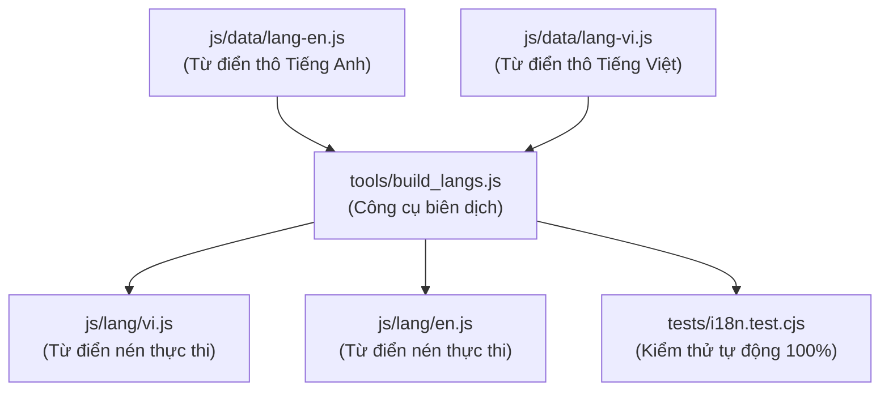

# Kiến Trúc Đa Ngôn Ngữ & Bản Địa Hóa (i18n) — ViTrainer

Tài liệu chi tiết về hệ thống dịch thuật đa ngôn ngữ (**Localization / Internationalization**) trong **ViTrainer**, quy trình bổ sung từ điển, và bộ công cụ kiểm thử tự động.

---

## 1. Các Ngôn Ngữ Được Hỗ Trợ & Nguyên Tắc Vận Hành

ViTrainer hỗ trợ chuyển đổi ngôn ngữ tức thì trong phần Cài Đặt (Settings) mà không cần tải lại trang:
- **Tiếng Việt (`vi`)**: Bản ngữ tiếng Việt hoàn chỉnh dành cho cộng đồng người chơi Việt Nam.
- **Tiếng Anh (`en`)**: Ngôn ngữ quốc tế chuẩn hóa toàn cầu.
### Nguyên Tắc Bất Di Bất Dịch:
- **Nguyên tác tên Pokémon & Chiêu thức**: Tên Pokémon (Pikachu, Bulbasaur, Rayquaza...) và tên chiêu thức chuẩn canon (Hyper Beam, Behemoth Blade, Roar of Time...) luôn được giữ nguyên theo danh pháp quốc tế nhằm bảo đảm tính đồng bộ với hệ thống dữ liệu PokeAPI và văn hóa cộng đồng người chơi.
- **Dịch thuật giao diện người dùng (UI Strings)**: Toàn bộ thông báo hệ thống, mô tả nâng cấp, thẻ kỹ năng, cạm bẫy, hướng dẫn tân thủ và cốt truyện đều phải được chuyển ngữ 100%, tuyệt đối không để sót chuỗi mã nguồn nội bộ hay tiếng Anh không mong muốn.

---

## 2. Cấu Trúc Tệp Tin & Luồng Biên Dịch Ngôn Ngữ

Hệ thống i18n của ViTrainer được tổ chức theo quy trình 2 lớp:



### Chi tiết các file:
1. **`js/data/lang-en.js`**: File từ điển Tiếng Anh ánh xạ từ khóa gốc mã nguồn nội bộ sang tiếng Anh (`"Key nội bộ": "English translation"`).
2. **`js/data/lang-vi.js`**: File từ điển Tiếng Việt ánh xạ từ khóa gốc mã nguồn nội bộ sang tiếng Việt (`"Key nội bộ": "Bản dịch Tiếng Việt"`).
3. **`tools/build_langs.js`**: Script tự động quét các file nguồn, đối chiếu từ điển thô, nén và sinh ra `js/lang/vi.js` và `js/lang/en.js`.
4. **`js/core/i18n.js`**: Động cơ dịch thuật thời gian thực trong game (`G.I18n`), quản lý biến `G.I18n.lang`, xử lý chuyển ngữ Canvas và DOM dynamically.

---

## 3. Cách Sử Dụng Trong Mã Nguồn Game

Trong mã nguồn JavaScript (`js/`):
- **Dịch trực tiếp qua hàm `G.T`**:
  ```javascript
  const msg = G.T('¡Ha aparecido una Grieta Dimensional!');
  ```
- **Dịch có tham số thay thế (Placeholders)**:
  ```javascript
  // Khóa gốc: "¡Fase {x}: {y} se regenera!"
  const msg = G.T('¡Fase {x}: {y} se regenera!', { x: 2, y: 'Gengar' });
  ```
- **Dịch trên Canvas đồ họa**:
  Động cơ `G.I18n` cung cấp các phương thức tự động dịch các chuỗi văn bản nổi (Floating Damage Text, Popups) hiển thị trên màn hình Canvas chiến đấu.

---

## 4. Quy Trình Kiểm Thử Đa Ngôn Ngữ Bắt Buộc (MANDATORY)

Mỗi khi bổ sung tính năng mới hoặc thêm chuỗi UI mới, lập trình viên và Agent **BẮT BUỘC** phải chạy bộ test kiểm tra:

```bash
node --test tests/i18n.test.cjs
```

Bộ kiểm thử thực hiện kiểm tra nghiêm ngặt:
1. **Không bỏ sót chuỗi (Full Coverage)**: Đảm bảo mọi từ khóa xuất hiện trong code đều có bản dịch trong `lang-en.js` và `lang-vi.js`.
2. **Hợp đồng tham số (Placeholder Contracts)**: Đảm bảo các tham số `{0}`, `{1}`, `{x}` trong chuỗi gốc và chuỗi dịch phải khớp chính xác 100% về số lượng và tên biến, tránh gây crash lúc ghép chuỗi.
3. **Bộ đệm Canvas & Font**: Đảm bảo chuỗi tiếng Việt có dấu hiển thị chuẩn xác trên Canvas mà không bị vỡ font hoặc tràn khung hiển thị.
