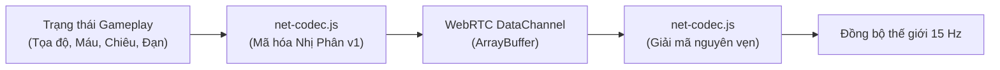

# Giao Thức Mạng Nhị Phân Co-op 8 Người (WebRTC) — ViTrainer

Tài liệu đặc tả chi tiết kiến trúc mạng ngang hàng P2P, bộ mã hóa nhị phân (**Binary Packet Codec v1**) và giao thức đồng bộ thời gian thực trong chế độ chơi hợp tác tối đa 8 người của **ViTrainer** tại `js/net/coop.js` và `js/net/net-codec.js`.

---

## 1. Tổng Quan Kiến Trúc Mạng (Networking Architecture)

ViTrainer áp dụng mô hình **Host-Authoritative Peer-to-Peer**:
- **Người chủ phòng (Host)**: Đóng vai trò là máy chủ tính toán vật lý, điều phối kẻ địch (Enemy Spawner Director), tính toán sát thương nhận vào, quản lý cơ chế Boss Đa Phase và đồng bộ trạng thái thế giới.
- **Khách tham gia (Clients - Tối đa 7 người)**: Gửi trạng thái điều khiển (Input, vị trí, góc bắn, kích hoạt chiêu) tới Host với tần số **15 Hz** thông qua kênh dữ liệu WebRTC DataChannel (`ordered: true, reliable: true`).
- **Hạ tầng STUN miễn phí**: Sử dụng máy chủ STUN công cộng của Google (`stun.l.google.com:19302`). Quá trình bắt tay kết nối (Signaling) được thực hiện qua Firebase Realtime Database hoàn toàn miễn phí.

---

## 2. Bộ Mã Hóa Nhị Phân (Binary Codec v1 — `net-codec.js`)

Để đảm bảo trận đấu mượt mà cho cả 8 người chơi trên đường truyền di động 4G/WiFi yếu, ViTrainer thay thế hoàn toàn chuỗi văn bản JSON cồng kềnh bằng bộ nén nhị phân siêu nhẹ, **tiết kiệm hơn 30% băng thông mạng**.

### 2.1. Cấu trúc khung nhị phân (Binary Frame Structure)
Mỗi gói tin nhị phân được đóng gói với cấu trúc chuẩn:
- **Byte 0 — Phiên bản (`VERSION = 1`)**: Định danh phiên bản codec nhằm tương thích ngược.
- **Byte 1 — Loại gói tin (`TAG`)**:
  - `0x01` — `FRAME_HOST`: Dữ liệu đồng bộ toàn diện từ Host tới Clients (vị trí kẻ địch, quái vật, hazards, nhặt ngọc, boss).
  - `0x02` — `FRAME_CLIENT`: Dữ liệu điều khiển từ Client tới Host (tọa độ người chơi, góc di chuyển, kích hoạt kỹ năng).
  - `0x03` — `EVENT_REVIVE`: Sự kiện hợp lực hồi sinh đồng đội.
  - `0x04` — `EVENT_EVO`: Đồng bộ hình thái tiến hóa và dạng Mega của đồng đội.
  - `0x05` — `EVENT_BOSS_PHASE`: Đồng bộ trạng thái Boss chuyển phase (Phase 2 Cuồng nộ, Phase 3 Mega).
  - `0x06` — `EVENT_PAUSE`: Thông báo tạm dừng trận đấu khi có thành viên mất kết nối.
- **Payload Data**: Chuỗi byte nén chứa các trường số nguyên, số thực dấu phẩy động dạng Fixed-Point, và chuỗi ký tự UTF-8 được mã hóa độ dài biến thiên.

---

## 3. Cơ Chế Chịu Lỗi & Tái Kết Nối Liền Mạch (Resilience & Seamless Rejoin)

1. **Tạm dừng khi mất kết nối (Disconnect Pause)**:
   - Nếu một người chơi bị rớt mạng do sóng yếu, trò chơi tự động tạm dừng đồng bộ trong vài giây để chờ đồng đội kết nối lại, tránh tình trạng bị quái cắn chết oan uổng.
2. **Nút Vàng Tái Kết Nối (Golden Reconnect Button)**:
   - Khi người chơi tải lại trang web hoặc mở lại trình duyệt, nếu phòng chơi cũ vẫn đang diễn ra, sảnh chính sẽ xuất hiện nút vàng nổi bật: **"Reconectarse" (Tái kết nối vào trận đang diễn ra)**.
   - Khi nhấn vào, hệ thống WebRTC bắt tay lại với Host và khôi phục toàn vẹn cấp độ, bộ chiêu và lượng máu hiện tại.
3. **Cơ Chế Hồi Sinh Đồng Đội Siêu Tốc (Superfast Revives)**:
   - Khi một thành viên bị gục ngã (Knocked Out), một vòng hào quang linh hồn sẽ xuất hiện quanh vị trí đó.
   - Thời gian hồi sinh được tự động rút ngắn theo số lượng người trong phòng:
     - 1 người cứu: Giảm từ 3.0s xuống còn **1.0s** khi phòng có 8 người.
     - Nhiều đồng đội đứng cùng trong vòng hào quang sẽ cộng dồn tốc độ cứu, giúp đưa đồng đội trở lại chiến trường gần như ngay lập tức.
4. **Quyền Quản Trị Của Chủ Phòng (Host Controls)**:
   - Chủ phòng có quyền kích hoạt đuổi (Kick) người chơi bị treo máy (AFK) hoặc mất mạng vĩnh viễn trực tiếp từ Menu Tạm Dừng để tiếp tục trận đấu mượt mà cho các thành viên còn lại.
