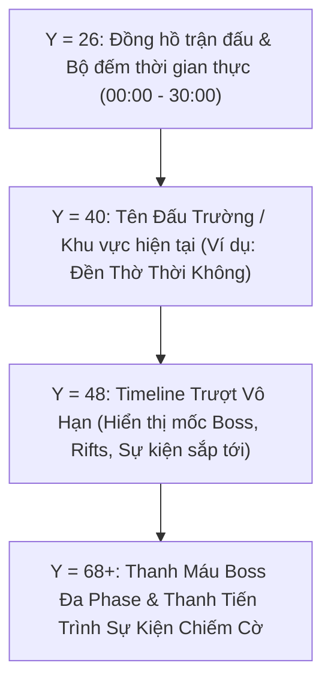

# Thiết Kế Giao Diện, Trải Nghiệm & Âm Thanh — ViTrainer
*(ViTrainer UI/UX, Visual Design & Audio Documentation)*

---

## 1. Triết Lý Thiết Kế Thị Giác (Visual Design Philosophy)

ViTrainer kết hợp hài hòa giữa nét hoài niệm của phong cách đồ họa **Retro 16-bit Pixel Art** (lấy cảm hứng từ series *Pokémon Mystery Dungeon: Explorers of Sky*) và phong cách giao diện hiện đại **Modern Dark Mode** với các điểm nhấn vàng kim hoàng gia (**Royal Gold accents**).

- **Màu nền chủ đạo**: Đen thẳm ma thuật (`#0a0b10` và `#12131a`), tạo độ tương phản tối đa cho các hiệu ứng chiêu thức và sprite nhân vật.
- **Màu nhấn thương hiệu**: Vàng kim hoàng gia (`#ffd23f` và `#f59e0b`), biểu trưng cho chiến thắng, cấp độ tối thượng và các phần thưởng huyền thoại.
- **Màu sắc 18 Hệ Pokémon**: Chuẩn hóa theo bảng màu quốc tế chính thức, giúp người chơi nhận diện thuộc tính chiêu thức tức thì.

---

## 2. Cấu Trúc Giao Diện Trong Trận Đấu (HUD Architecture)

Để đảm bảo thông tin hiển thị rõ ràng trên mọi kích thước màn hình (từ smartphone màn hình dọc/ngang đến màn hình máy tính 4K), các thành phần HUD đỉnh màn hình được phân chia theo tọa độ trục Y nghiêm ngặt, loại bỏ hoàn toàn hiện tượng đè chữ:

### 2.1. Khay 6 Ô Chiêu Thức & Huy Hiệu Phân Loại (Kind Badges)
- Khay chiêu thức được đặt gọn gàng ở góc dưới màn hình, hiển thị tiến trình hồi chiêu và cấp độ tiến hóa (+, ++, +++).
- **Huy hiệu kiểu đòn (Kind Badges)**: Mỗi chiêu thức gắn kèm một biểu tượng mini 10x10 định danh:
  - `Physical` (Kiếm cam): Đòn đánh Vật Lý.
  - `Special` (Lửa tím): Đòn đánh Phép / Đặc Biệt.
  - `Exclusive` (Ngôi sao vàng): Chiêu thức Độc Quyền Thần Thoại.

### 2.2. Cảnh Báo Vùng Nguy Hiểm (Telegraphed Hazards) & Chữ Báo Sơ Hở
- Mọi đòn đánh lớn từ Boss đều có vệt cảnh báo đỏ/vàng trên sàn đấu trước khi giáng xuống từ 0.6s đến 1.2s, cho phép người chơi phản ứng né đòn.
- Khi Boss vừa tung xong đại chiêu, chữ nổi rực rỡ màu xanh lam **`VULNERABLE!`** xuất hiện trên đỉnh đầu Boss, báo hiệu cửa sổ 1.5 giây nhận thêm $+50\%$ sát thương để người chơi phản công.

---

## 3. Giao Diện Pokédex Ảo Vô Tận & Cây Tiến Hóa Trực Quan

### 3.1. Cuộn Ảo Vô Tận (Virtual Scrolling Grid)
- Pokédex chứa hơn 1.000 loài Pokémon nhưng vẫn duy trì tốc độ khung hình 60fps mượt mà nhờ cơ chế Virtual Scrolling: chỉ render các thẻ Pokémon đang nằm trong khung nhìn màn hình, tái sử dụng các node DOM khi cuộn.
- **Decoupled Scroll**: Tách biệt hoàn toàn thanh cuộn của danh sách bên trái và bảng chi tiết Pokémon bên phải, không gây giật lag hay nhảy trang.

### 3.2. Cây Tiến Hóa Trực Quan (Interactive Evolution Tree)
- Mở bảng chi tiết Pokémon sẽ hiển thị toàn bộ chuỗi tiến hóa:
  - Liên kết các bậc tiến hóa chính (`Fase 1` $\rightarrow$ `Fase 2` $\rightarrow$ `Fase 3`).
  - Nút chuyển hình thái **Mega / Primal / Apex** với hiệu ứng phát sáng hoàng kim.
  - Hàng biến thể vùng miền (**Regional Variants** như Alolan, Galarian, Hisuian, Paldean) cho phép bấm vào để xem trước ngoại hình và chỉ số tức thì.

---

## 4. Giao Diện Quản Lý Tài Khoản Mới (Account Management UI)

Trong màn hình **Cài Đặt $\rightarrow$ Tab Tài Khoản (Ajustes $\rightarrow$ Cuenta)**:
- **Hiển thị thông tin đăng nhập**:
  - Trạng thái Google: Badge xanh `✓ Google vinculado` hoặc nút `Vincular con Google`.
  - Trạng thái Tài khoản/Mật khẩu: Badge xanh `✓ Usuario: [Tên]` hoặc khối form liên kết trực quan.
- **Khối liên kết Tên/Mật khẩu cho tài khoản Google**:
  - Cung cấp ô nhập *Tên tài khoản mới* và *Mật khẩu* trực tiếp trong phần Cài đặt.
  - Nút bấm *"Vincular"* gửi yêu cầu tức thì tới Firebase Auth và cập nhật giao diện không cần tải lại trang.
- **Hộp thoại gợi ý thông minh (`#scr-link-account`)**:
  - Hiển thị pop-up khi người dùng đăng nhập bằng Google vào sảnh chính lần đầu, tạo sự thuận tiện tối đa cho việc liên kết đa phương thức.

---

## 5. Kiến Trúc Âm Thanh (Web Audio API Architecture)

Hệ thống âm thanh của ViTrainer sử dụng Web Audio API cho độ trễ gần như bằng 0:
- **Nhạc nền thích ứng (Adaptive BGM)**:
  - Nhạc nền làng thanh bình khi ở Sảnh chính (`village`).
  - Nhạc nền hầm ngục căng thẳng khi chiến đấu quái bầy (`dungeon`).
  - Nhạc nền hoành tráng hào hùng khi chạm trán Boss và Phán Quyết Arceus (`boss`, `legend`, `judgment`).
- **Bộ hiệu ứng SFX phong phú**:
  - Âm thanh va chạm, tiếng chém kiếm khí, đạn pháo nổ, sấm sét giật, đóng băng.
  - Âm thanh chuông ngân báo hiệu Cổng Không Gian mở ra và tiếng hiệu ứng chúc mừng khi thức tỉnh Mega.
- **Tùy chỉnh âm lượng độc lập**: Cho phép người chơi điều chỉnh thanh trượt âm lượng Nhạc nền (BGM) và Hiệu ứng (SFX) riêng biệt trong Cài đặt.
