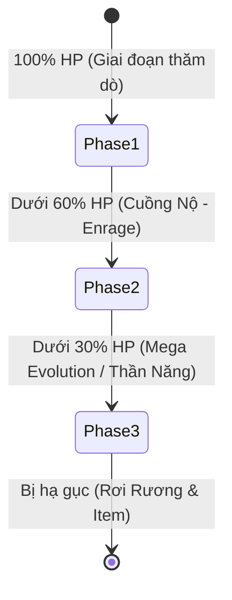

# Hệ Thống Boss & Cơ Chế Đột Phá — ViTrainer

Tài liệu chi tiết về cơ chế vận hành Boss trong **ViTrainer** tại `js/data/enemies.js` và `js/entities/enemy.js`: bảng chu kỳ xuất hiện, công thức scale máu/sát thương, cơ chế 3 Phase tiến hóa, cửa sổ sơ hở `VULNERABLE!`, danh mục kỹ năng phân định Vật Lý vs Phép, và bể chọn Boss theo thời gian.

---

## 1. Chu Kỳ Xuất Hiện & Bảng Thông Số Cơ Bản (Boss Slots)

Trong mỗi trận đấu tiêu chuẩn 30 phút, cứ mỗi **3 phút (180 giây)** sẽ có một Đại Boss xuất hiện từ hư không với thông số tương ứng theo mốc thời gian:

| Mốc thời gian | Tên Mốc | Máu gốc (`hp`) | Sát thương gốc (`dmg`) | Kinh nghiệm (`xp`) | Bể BST lựa chọn |
| :---: | :---: | :---: | :---: | :---: | :---: |
| **Phút 03:00** (180s) | Boss 1 | 2,600 | 16 | 450 | 490 – 545 |
| **Phút 06:00** (360s) | Boss 2 | 9,500 | 26 | 900 | 520 – 580 |
| **Phút 09:00** (540s) | Boss 3 | 36,000 | 42 | 1,600 | 540 – 600 |
| **Phút 12:00** (720s) | Boss 4 | 120,000 | 65 | 2,600 | 580 – 700 |
| **Phút 15:00** (900s) | Boss 5 | 320,000 | 95 | 4,500 | 600 – 700 |
| **Phút 18:00** (1080s) | Boss 6 | 450,000 | 95 | 6,000 | 600 – 720 |
| **Phút 21:00** (1260s) | Boss 7 | 850,000 | 110 | 8,500 | 620 – 750 |
| **Phút 24:00** (1440s) | Boss 8 | 1,500,000 | 130 | 12,000 | 650 – 780 |
| **Phút 27:00** (1620s) | Boss 9 (Chung kết) | 2,400,000 | 155 | 16,000 | 680 – 800 |

*Ghi chú*: Boss thông thường trong danh sách là các loài mạnh mẽ (Pseudolegendary, Slaking, Volcarona, v.v.). Các thần thú Huyền thoại tối thượng (Mewtwo, Rayquaza, Dialga, Palkia, Giratina...) chỉ xuất hiện độc quyền trong **Cổng Không Gian (Dimensional Rift)** hoặc Sự kiện Phán Quyết của Arceus ở phút 30.

---

## 2. Công Thức Tăng Tiến Sức Mạnh Theo Thời Gian (Boss Scaling)

Để đảm bảo trận đấu kịch tính nhưng không gây ức chế (không để boss bất tử và tránh một đòn hạ gục người chơi), hệ thống áp dụng hệ số scale động `bossScale(t)` tại `js/data/enemies.js`:

$$p = \frac{t}{1800}$$

$$\text{scale}_{hp}(t) = 1 + \left(\frac{t}{600}\right) \times (1 + 0.85 \times p)$$

$$\text{scale}_{dmg}(t) = 1 + \left(\frac{t}{550}\right) \times (1 + 0.50 \times p)$$

$$\text{scale}_{spd}(t) = 1 + \min\left(0.25, \; \frac{t}{1800} \times 0.25\right)$$

### Cơ Chế Bảo Vệ Chống Sốc Tử Vong (One-Shot Protection):
- Mọi đòn đánh trực tiếp hoặc cạm bẫy diện rộng từ Boss đều phải tuân thủ trần sát thương tối đa: **Không được vượt quá 40% lượng Máu tối đa của người chơi trong 01 đòn đánh**.
- Người chơi luôn có cơ hội phản ứng, kích hoạt hồi phục hoặc sử dụng đai cứu mạng `Banda Focus` khi gặp tình huống nguy hiểm.

---

## 3. Cơ Chế 3 Phase Chiến Đấu Của Boss

Khi chạm trán Boss, trận đánh được phân chia thành 3 giai đoạn rõ rệt với cơ chế biến đổi hình thái và hành vi:

### 3.1. Phase 1 — Khởi Động Trận Đánh (100% – 60% HP)
- Boss di chuyển với tốc độ tiêu chuẩn, duy trì khoảng cách hoặc lao tới tấn công theo bản năng loài (`chase`, `charger`, `ranged`).
- Tung các kỹ năng đơn lẻ theo chu kỳ hồi chiêu cơ bản.

### 3.2. Phase 2 — Trạng Thái Cuồng Nộ (`FASE DE FURIA` / Enrage, dưới 60% HP)
- Khi lượng máu tụt xuống dưới 60%, Boss kích hoạt chế độ Cuồng Nộ:
  - **Tăng tốc di chuyển**: Tốc độ tăng ngay **+25%** (`spd *= 1.25`).
  - **Giảm thời gian niệm chiêu (Wind-up)**: Giảm 20% thời gian báo động chiêu thức (`f = 0.8`).
  - **Triệu hồi tay sai (Minions)**: Tự động gọi một toán đệ tử cùng hệ vây bọc người chơi (`spawnMinionsForBoss`).
  - **Cường hóa số lượng đạn chiêu thức**:
    - `beam`: Bắn 6 tia chùm (thay vì 4 tia).
    - `nova`: Tỏa 22 viên đạn hình cầu (thay vì 16 viên).
    - `blizzard`: Tỏa 20 viên đạn băng (thay vì 14 viên).
    - `rain`: Mưa năng lượng 7 vùng nổ liên hoàn (thay vì 5 vùng).
  - **Hồi phục & Kháng hiệu ứng**: Nhận thêm 40% máu tối đa, tăng 20% sát thương đòn đánh và có **2.0 giây miễn nhiễm toàn bộ khống chế (CC Immune)**.

### 3.3. Phase 3 — Tiến Hóa Mega / Thần Năng Thức Tỉnh (Dưới 30% HP)
- Khi máu xuống dưới 30%, Boss đột phá sức mạnh lần cuối:
  - **Biến đổi ngoại hình**: Nếu Boss có hình thái Mega trong hệ thống (Gengar Mega, Tyranitar Mega, Lucario Mega, Garchomp Mega, Salamence Mega...), Boss lập tức chuyển sang Sprite Mega, mở rộng thể tích (`G.Sprites.bossScale`).
  - **Tăng cường sinh lực**: Tăng thêm 60% máu tối đa, tăng thêm 20% sát thương, nhận thêm 2.0 giây Kháng Hiệu Ứng.
  - **Đồng bộ Multiplayer**: Thông tin chuyển Phase và biến hình Mega của Boss được gửi đồng bộ theo thời gian thực tới tất cả các người chơi trong phòng Co-op 8 người thông qua WebRTC.

---

## 4. Cửa Sổ Sơ Hở Phản Công (Vulnerable Window)

Sau khi hoàn thành bất kỳ chiêu thức diện rộng hoặc đòn lướt tấn công cực đại nào (`bossEnd`), Boss sẽ tiêu hao năng lượng và rơi vào trạng thái sơ hở:

- **Thời gian sơ hở**: Kéo dài đúng **1.5 giây** (`vulnerableT = 1.5`).
- **Hiển thị trực quan**: Xuất hiện dòng chữ rực rỡ màu xanh lam **`VULNERABLE!`** nổi bật phía trên đầu Boss.
- **Hiệu ứng sát thương**: Toàn bộ sát thương mà Boss phải gánh chịu từ mọi nguồn (kỹ năng, đạn bay, đốt cháy, độc tố, sét giật) trong thời gian này được **TĂNG THÊM 50%** ($\times 1.50$).
- **Chiến thuật**: Đây là thời điểm vàng để người chơi bung các chiêu thức dồn sát thương cực đại, áp sát xả hỏa lực nhằm rút cạn lượng máu Boss nhanh nhất.

---

## 5. Danh Mục Tuyệt Kỹ Của Boss — Phân Định Vật Lý vs Phép

Mọi đòn đánh và bẫy diện rộng (Hazards) của Boss đều được phân loại rành mạch để tương tác chính xác với chỉ số **Phòng Thủ Vật Lý (PDEF)** hoặc **Phòng Thủ Phép (SDEF)** của người chơi:

### 5.1. Kỹ Năng Sát Thương Vật Lý (Physical — Cản bởi Giáp Vật Lý `PDEF`)
| Kỹ năng | Hành vi hiển thị | Mô tả hiệu ứng & Vùng tác động |
| :--- | :---: | :--- |
| `slam` | Vùng tròn dưới chân Boss | Boss nén sức mạnh rồi dậm mạnh xuống đất, gây sát thương chấn động trong bán kính $110 + r$. |
| `dash` | Vệt chữ nhật dài báo trước | Boss lao vun vút theo một đường thẳng dài 360 đơn vị, ủi bay và gây sát thương nặng lên mục tiêu trên đường đi. |
| `leap` | Vùng tròn tại vị trí người chơi | Boss nhảy vọt lên không trung rồi giáng mạnh xuống vị trí người chơi đang đứng sau 1.05 giây. |
| `dragon_rush` | Vệt quét dài + Vùng nổ điểm đến | Rồng bay càn quét đường dài 420 đơn vị, sau đó phát nổ sóng xung kích bán kính 120 đơn vị tại điểm kết thúc. |
| **Cận chiến (Melee Touch)** | Va chạm thể xác | Đòn húc trực tiếp khi Boss áp sát người chơi. |

### 5.2. Kỹ Năng Sát Thương Phép (Special — Cản bởi Giáp Phép `SDEF`)
| Kỹ năng | Thuộc tính hệ | Mô tả hiệu ứng & Vùng tác động |
| :--- | :---: | :--- |
| `inferno` | **Hỏa (Fire)** | Vùng lửa thiêu đốt tâm điểm kèm 4 chùm tia lửa hình chữ thập quét dài 380 đơn vị theo 4 hướng. |
| `blizzard` | **Băng (Ice)** | Bão tuyết lạnh giá bán kính 160 đơn vị bùng phát quanh Boss kèm loạt đạn băng 360 độ (14 - 20 đạn). |
| `thunderstorm` | **Điện (Electric)** | Gọi sấm sét giáng liên hoàn 4 đợt trực tiếp vào vị trí của người chơi với độ trễ tăng dần. |
| `toxic_bloom` | **Độc (Poison)** | Bung nở 5 đóa hoa độc tím xung quanh mục tiêu, gây sát thương ăn mòn diện rộng. |
| `shadow_void` | **Ma (Ghost)** | Hư vô bóng tối mở rộng bán kính 140 đơn vị, phóng loạt đạn linh hồn truy kích. |
| `rain` | Hệ của Boss | Mưa năng lượng rơi ngẫu nhiên 5 – 7 vùng bộc phá xung quanh vị trí người chơi. |
| `beam` | Hệ của Boss | Bắn chùm laser năng lượng hình quạt từ 4 đến 6 tia dài 440 đơn vị quét qua sàn đấu. |
| `nova` / `volley` | Hệ của Boss | Tỏa đạn ma thuật hình cầu 360 độ (16 – 22 viên) hoặc bắn tỉa loạt đạn góc rộng. |
