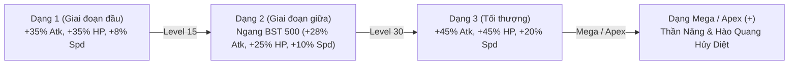
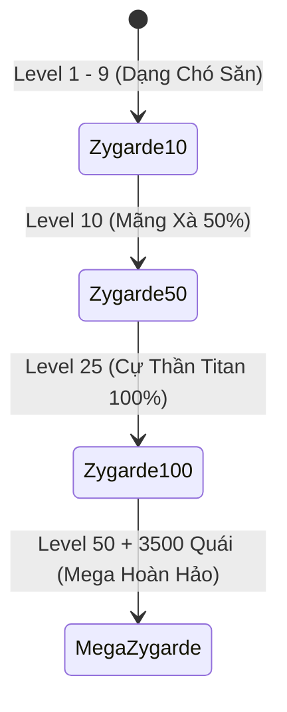

# Hệ Thống Pokémon & Tiến Hóa — ViTrainer

Tài liệu chi tiết về cơ chế Pokédex, cấu trúc cây tiến hóa, hệ số cân bằng chỉ số 3 bậc, mốc thức tỉnh cấp độ, hình thái Mega/Primal/Ultra và dòng dõi thần thoại Zygarde trong **ViTrainer**.

---

## 1. Tổng quan Pokédex & Phân Loại Loài

Toàn bộ Pokémon trong game được quản lý tại `js/data/pokedex.js` và `js/data/evolutions.js` với các thông số gốc trích xuất từ dữ liệu chính thức Pokémon Showdown và PokeAPI:
- **Chỉ số cơ bản (Base Stats)**:
  - `hp`: Máu cơ bản.
  - `atk`: Tấn công tổng hợp.
  - `pa` / `sa`: Tấn công Vật Lý (Physical Attack) & Tấn công Phép / Đặc Biệt (Special Attack).
  - `df` / `sd`: Phòng thủ Vật Lý (Physical Defense) & Phòng thủ Phép (Special Defense).
  - `spd`: Tốc độ di chuyển cơ bản.
  - `bst`: Tổng chỉ số cơ bản (Base Stat Total).
- **Phân cấp độ hiếm (Gacha & Rarity)**:
  - `Rarity 1 - 2`: Dạng khởi đầu của Pokémon thông thường (Pidgey, Rattata, Caterpie...).
  - `Rarity 3`: Pokémon 3 bậc tiến hóa, Pokémon 2 bậc mạnh mẽ (Starter Gen 1-9, Gible, Dratini, Beldum...).
  - `Rarity 4`: Pokémon bán huyền thoại (Pseudo-Legendary hoàn thiện), Pokémon thần bí đặc biệt (Tyranitar, Metagross, Garchomp, Lucario, Zoroark...).
  - `Rarity 5`: Huyền thoại & Thần thoại tối cao (Mewtwo, Rayquaza, Dialga, Palkia, Giratina, Arceus, Zygarde, Zacian, Zamazenta...).

---

## 2. Quy Chuẩn Cân Bằng Chỉ Số Tiến Hóa (Stage Balance)

Để khắc phục tình trạng các Pokémon 3 bậc quá yếu ở giai đoạn đầu trận, hệ thống áp dụng thuật toán cân bằng chỉ số động trong `js/entities/player.js`:

### Chi tiết hệ số cộng dồn theo bậc:
1. **Dạng 1 (Base Stage của chuỗi 3 bậc)**:
   - Tấn công cơ bản: $\times 1.35$ (+35%).
   - Máu tối đa: $\times 1.35$ (+35%).
   - Tốc độ di chuyển: $\times 1.08$ (+8%).
   - *Mục đích*: Giúp người chơi dễ dàng vượt qua 3 phút đầu game mà không bị lép vế trước quái bầy.
2. **Dạng 2 (Middle Stage)**:
   - Tấn công cơ bản: $\times 1.28$ (+28%).
   - Máu tối đa: $\times 1.25$ (+25%).
   - Tốc độ di chuyển: $\times 1.10$ (+10%).
   - Hồi ngay **50% lượng máu tối đa** khi biến hình.
   - *Mục đích*: Sức mạnh tương đương một Pokémon đơn bậc mạnh mẽ (~500 BST baseline).
3. **Dạng 3 (Final Stage)**:
   - Tấn công cơ bản: $\times 1.45$ (+45%).
   - Máu tối đa: $\times 1.45$ (+45%).
   - Tốc độ di chuyển: $\times 1.20$ (+20%).
   - Hồi ngay **50% lượng máu tối đa** khi biến hình.
   - *Mục đích*: Vượt trội khoảng 30% so với dạng 2, tạo cảm giác đột phá sức mạnh rõ rệt khi bước vào nửa sau trận đấu.

---

## 3. Các Dạng Cây Tiến Hóa & Mốc Cấp Độ Trong Trận

Quá trình tiến hóa trong trận đấu được kích hoạt tự động thông qua giao diện rút thẻ tiến hóa (`promptEvo`):

### 3.1. Chuỗi 3 bậc (`3stage`)
- **Ví dụ**: Bulbasaur $\rightarrow$ Ivysaur $\rightarrow$ Venusaur; Charmander $\rightarrow$ Charmeleon $\rightarrow$ Charizard.
- **Level 15**: Thăng cấp lên **Dạng 2** (`Fase 2`), hồi 50% HP.
- **Level 30**: Thăng cấp lên **Dạng 3** (`Fase 3`), hồi 50% HP. Nếu Pokémon có hình thái Mega, giao diện sẽ mở tiếp thẻ tiến hóa Mega hoặc trạng thái Apex (+).

### 3.2. Chuỗi 2 bậc (`2stage`)
- **Ví dụ**: Riolu $\rightarrow$ Lucario; Magikarp $\rightarrow$ Gyarados; Pikachu $\rightarrow$ Raichu.
- **Level 15**: Tiến hóa lên **Dạng 2**, hồi 50% HP.
- **Level 30**: Mở khóa **Mega Evolution** (nếu có) hoặc tiến vào trạng thái **Apex (+)** (+30% sát thương, hồi đầy 100% HP, nhận Vương miện Ánh Sáng Thiên Giới).

### 3.3. Dạng Đơn Bậc & Huyền Thoại (`single`)
- **Ví dụ**: Mewtwo, Rayquaza, Dialga, Palkia, Darkrai, Heracross, Skarmory...
- **Level 15 — Thức Tỉnh I (`Despertar I`)**: Khai mở tiềm năng nguyên thủy, nhận thêm **+25% Máu** và cường hóa các chỉ số chiến đấu.
- **Level 30 — Thức Tỉnh Apex (+) / Mega**:
  - Nếu có dạng Mega (như Mewtwo X/Y, Rayquaza): Cho phép tiến hóa Mega.
  - Nếu không có Mega: Nhận ấn bản **Apex (+)**: +35% tổng sát thương đầu ra và hồi phục sinh lực vượt trội.

### 3.4. Dòng Tiến Hóa Phân Nhánh (`branch`)
- **Ví dụ**: 
  - Eevee (Vaporeon, Jolteon, Flareon, Espeon, Umbreon, Leafeon, Glaceon, Sylveon).
  - Ralts (Kirlia $\rightarrow$ Gardevoir hoặc Gallade).
  - Slowpoke (Slowbro hoặc Slowking).
  - Tyrogue (Hitmonlee, Hitmonchan, Hitmontop).
- **Cơ chế**: Khi đạt cấp độ tiến hóa, hệ thống hiển thị danh sách các thẻ nhánh tương ứng kèm hệ và thuộc tính để người chơi tự do lựa chọn theo phong cách build.

---

## 4. Hệ Thống Mega Evolution & Hình Thái Đặc Biệt

Khi tiến hóa thành Mega, Primal Reversion (Nguyên Thủy), Ultra Burst hoặc Hợp Thể, Pokémon sẽ nhận được bước nhảy vọt toàn diện về sức mạnh:

### 4.1. Chỉ số Thần Năng khi Mega:
| Chỉ số | Mức tăng |
| :--- | :--- |
| **Sát thương cơ bản (`baseAtk`)** | **+50%** |
| **Máu tối đa (`maxHp`)** | **+45%** |
| **Tốc độ di chuyển (`baseSpd`)** | **+25%** |
| **Tỉ lệ Chí Mạng (`critChance`)** | **+15%** |
| **Giảm sát thương nhận vào (`dmgReduce`)** | **-20%** (Cộng dồn tối đa 60%) |
| **Thời gian hồi tất cả chiêu (`cdMul`)** | **-15%** |
| **Hồi phục sinh lực** | **Hồi đầy 100% Máu** |

### 4.2. Hào Quang Thần Năng (Mega Aura)
Tất cả Pokémon ở dạng Mega/Primal/Ultra đều sở hữu nội tại ẩn **Mega Aura**:
- Cứ mỗi **2.2 giây**, Pokémon tự động phát xạ một vòng tròn sóng xung kích thần năng 360 độ (`G.FX.ring`).
- Gây sát thương diện rộng và hất văng nhẹ mọi kẻ địch áp sát trong bán kính 220 đơn vị.

### 4.3. Thức Tỉnh Nhờ Chiêu Thức Độc Quyền Bậc + (`Exclusive Plus Move Awakening`)
Một số loài Pokémon thần thoại đặc biệt có thể mở khóa hình thái tối thượng ngay trong trận đấu khi nâng cấp chiêu thức độc quyền của mình lên bậc **+**:

| Pokémon | Chiêu thức kích hoạt | Hình thái thức tỉnh | Hiệu ứng đặc biệt |
| :--- | :--- | :--- | :--- |
| **Necrozma** (`dex: 800`) | `prismatic-laser+` | **Ultra Necrozma** (`10157`) | Quang phổ thăng hoa, chuyển hệ sang Tâm Linh/Rồng, tăng vọt sát thương diện rộng. |
| **Magearna** (`dex: 801`) | `fleur-cannon+` | **Mega Magearna** (`10801`) | Khai mở Trái Tim Linh Hồn, bắn pháo hoa tầm nhiệt liên tục. |
| **Zeraora** (`dex: 807`) | `plasma-fists+` | **Overdrive Zeraora** (`10807`) | Quá tải điện tích, chuỗi đấm phóng sét lan 5 mục tiêu gây sốc điện tê liệt. |

---

## 5. Dòng Tiến Hóa Thần Thoại Zygarde (Người Bảo Hộ Sinh Thái)

Zygarde sở hữu một chuỗi nhiệm vụ và dòng tiến hóa hoàn toàn độc bản trong ViTrainer:

1. **Zygarde Dạng 10% (Chó Săn Tế Bào - Dex: 10118)**:
   - Xuất phát điểm từ Level 1 đến Level 9. Tốc độ di chuyển cực nhanh nhưng lượng máu và sát thương ở mức khiêm tốn.
2. **Zygarde Dạng 50% (Mãng Xà Giám Sát - Dex: 718)**:
   - Đạt **Level 10**: Nhận thẻ tiến hóa biến đổi thành dạng Rắn Mãng Xà khổng lồ. Tăng 40% phòng ngự và mở rộng tầm đánh.
3. **Zygarde Dạng 100% (Cự Thần Hoàn Thiện - Dex: 10120)**:
   - Đạt **Level 25**: Kích hoạt thể biến hình Complete Forme Titan.
   - **Đặc quyền tối thượng**: Được **TẶNG MIỄN PHÍ** 01 ô chiêu thức thứ 5 và tự động học chiêu thức độc quyền **Core Enforcer** mà không cần qua thẻ roll.
4. **Mega Zygarde (Thần Quang Vũ Trụ - Dex: 10121)**:
   - **Điều kiện**: Đạt **Level 50** và tiêu diệt tích lũy **3,500 quái vật** trong trận đấu.
   - Chiêu thức độc quyền `core-enforcer` lập tức được thăng hoa thành siêu pháo ánh sáng **Nihil Light**, quét sạch toàn bộ bản đồ với sức mạnh hủy diệt.

---

## 6. Trang Bị Hỗ Trợ Tiến Hóa (Held Items Tương Thích)

- **Mega Aro (`keystone`)**: Kích hoạt tiến hóa Mega ngay lập tức mà không cần chờ đạt cấp độ 30, đồng thời tăng 10% chỉ số toàn diện và +15% sát thương STAB (Cùng hệ).
- **Khoáng Thạch Tiến Hóa (`eviolite`)**: Tăng **+40% Phòng thủ Vật Lý và Phép** nếu Pokémon chưa đạt dạng tiến hóa cuối cùng (Cực kỳ hiệu quả khi dùng cho các Pokémon Dạng 1 hoặc Dạng 2 trong chuỗi 3 bậc).
- **Punta ADN (`dnasplicers`)**: Cho phép Kyurem hợp thể thành Kyurem Đen hoặc Kyurem Trắng.
- **Ultranecrostal Z (`ultranecroziumz`)**: Đánh thức sức mạnh Ultra Necrozma.
- **Griseosfera (`griseousorb`)**: Chuyển đổi Giratina sang Dạng Gốc (Origin Forme).
